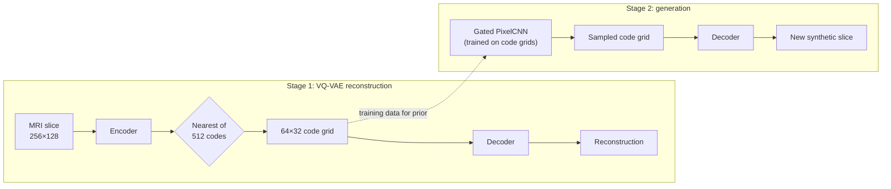

# Generating Synthetic Hip MRI Slices with a VQ-VAE and PixelCNN Prior \[Hard Difficulty]

## I Problem \& Algorithm

### 1\. Problem

Open-source Hip MRI data is scarce due to patient confidentiality laws, however, generative synthetic hip MRI slices which are anatomically plausible, diverse and not memorised from patient training data can be used to address this scarcity. This project investigates the capacity of VQ-VAE to learn a discrete codebook representation of hip MRI, and a PixelCNN prior capable of sampling from the learnt latent representation to generate synthetic images. The capabilities of this approach shall be directly compared to a baseline VAE's capacity for reconstruction and generation.

### 2\. How it Works

1. **VQ-VAE**: (a) The encoder downsamples each 256 x 128 slice into 64 x 32 latent map where each position represents a learnt feature vector. (b) The codebook learns 512 latent vectors where each encoder output is mapped to its closest (by Euclidean distance) codebook vector. Then, each codebook vector is updated by an exponential moving average of the encoder outputs assigned to each specific vector. To stop codebook collapse, the codebook was initialised by encoder outputs and vectors unused for 20 training steps were reinitialised to a random current encoder output. (c) The decoder upsamples the 64 x 32 latent map of codebook vectors to a reconstructed 256 x 128 MRI slice.
Loss Function:
```math
\mathcal{L} = \frac{1}{N}\lVert x-\hat{x}\rVert_2^2 + \beta\frac{1}{M}\lVert z_e(x)-\mathrm{sg}[z_q(x)]\rVert_2^2
```
2. **Gated PixelCNN:** learns the distribution of codebook vectors autoregressively and each code is predicted from all codes above it and to its left. Generated synthetic slices are formed by sampling a grid one vector at a time and passing the generated 64 x 32 map through the VQ-VAE decoder.
3. **VAE:** learns a continuous latent representation by encoding each input into a probability distribution, sampling a latent vector and decoding it to reconstruct the input. Generated samples are formed by sampling and decoding the learnt latent distribution.

### 3\. Algorithm Visualisation



## II Feasibility Review

### 1 User Need, Scope \& Acceptance Criteria

#### 1.1 User Need

* Production of synthetic medical cohorts for hip MRI training data. Requires generated images that satisfy:

  1. Fidelity (plausible anatomy)
  2. Diversity (no model collapse)
  3. Privacy (no memorised scans from training)

#### 1.2 Scope

* Generating 2D axial pelvic MRI slices (256 × 128) and comparing them with simpler VAE baselines on held-out patients.

#### 1.3 Acceptance Criteria

1. **Reconstruction fidelity:** Mean SSIM of VQ-VAE reconstructions (> 0.6)
2. **Generated-slice fidelity:** Mean SSIM of each sample to nearest real slice (> 0.3)
3. **No Memorisation:**

   * (a) Proportion of generated samples above 95th percentile NN-SSIM of validation patients (< test-patient rate)
   * (b) Proportion of near-duplicate samples (NN-SSIM > 0.95) (< test-patient rate)
4. **Coverage \& Density:**

   * (a) Mean Pairwise SSIM (within ±25% of Real Test Slices)
   * (b) Fidelity and diversity metrics (Naeem et al., 2020) (> 50% of real patient density \& coverage)
5. **Resource Budget:**

   * (a) Peak training VRAM (< 16 GB)
   * (b) Average generation time per slice on an A100 (< 1 s)

### 2\. Model Choice \& Course Concepts

* **VQ-VAE (van den Oord et al., 2017):** the encoder downsamples the image into a 64 × 32 grid, with each position assigned one of 512 learned codes. The codebook is gradually updated using exponential moving averages. It uses a straight-through estimator to allow gradients to pass through the discrete code selection during training.
* **Gated PixelCNN Prior (van den Oord et al., 2016):** learns the patterns and relationships between the VQ-VAE's discrete codes to generate new code grids one position at a time. Then the VQ-VAE decoder converts these grids into synthetic MRI slices.
* **Baseline:** a Gaussian VAE (Kingma \& Welling, 2014) uses the same encoder and decoder architecture as the VQ-VAE to compare its discrete code representation \& the prior against the VAE’s latent representations in generating synthetic MRI slices.

### 3\. Preliminary Feasibility Evidence

* **Data:** 11460 / 660 / 540 slices from 31 / 4 / 3 patients (train / validate / test). Confirmed no patient leakage between splits. 60 slices which were 256 x 144 were centre-cropped. Pixel values were percentile-clipped and min-max scaled to \[0, 1] as SSIM and PSNR require known range.
* **Smoke Test:** 256 slices per split. Peak VRAM of 1.1 GB per autoencoder, 5.5 GB for prior. Evidence of codebook collapse (2/512 codes used), plan to initialise codebook with encoder outputs and reinitialise unused codes every 20 training iterations.

### 4\. Risks, Budget \& Fallback

#### 4.1 Risks

* **Prior over-fitting:** Implement mirror training samples, dropout, weight decay, and decreasing number of channels based on training vs validation performance
* **Unfair baseline:** Test VAE with varying KL-weights

#### 4.2 Budget

* **A100:** 4 GPU hours for main training, prediction and evaluation pipeline and 13 GPU-hours for side experiments (regularisation comparison and hyperparameter optimisation)

#### 4.3 Next

* Optimise regularisation of prior and KL weight of VAE. Then train models and evaluate pairwise / nearest neighbour SSIM, diversity, memorisation, and whether model collapse occurs.

## III Dependencies

### 1\. Packages

| Python | PyTorch | torchvision | nibabel | NumPy | matplotlib | tqdm |
|---|---|---|---|---|---|---|
| 3.13.2 | 2.7.0 (CUDA 12.6) | 0.22.0 | 5.4.2 | 2.2.6 | 3.10.3 | 4.67.1 |

Run on Rangpur A100.

### 2\. Reproducibility
- Fixed seeds: 42 (training), 0 (sampling)
- Successfully reproduced all metrics (predict.py)

### 3\. Usage

| File | Contents |
|---|---|
| `slurm/` | Rangpur scripts |
| `dataset.py` | Nifti loading, data processing, data audit |
| `modules.py` | VQ-VAE, VAE, EMA codebook, Gated PixelCNN |
| `train.py` | Training, validation, checkpointing, produces loss curves |
| `predict.py` | Tests benchmark, sampling, memorisation, produces figures |
| `experiments.py` | Prior regularisation, VAE KL optimisation |

```bash
sbatch slurm/smoke_test.sbatch      # smoke test
bash slurm/run_all.sh               # trains VAE, VQ-VAE, CNN prior, and runs predict.py
sbatch slurm/experiments.sbatch     # side experiments: VAE KL optimisation, and prior regularisation
```

## IV Example Inputs, Outputs \& Visual Plots

## V Pre-Processing

## VI Investigation of the Open Research Dilemma

### 1\. Quantitative Benchmarking

### 2\. Resource Profiling

### 3\. Qualitative Error Autopsies

### 4\. Engineering Recommendations \& Trade-Offs

## VII Artificial Intelligence Usage Disclosure

