# Generating Synthetic Hip MRI Slices with a VQ-VAE and PixelCNN Prior \[Hard Difficulty]

## I Problem \& Algorithm

### 1\. Problem

Open-source Hip MRI data is scarce due to patient confidentiality laws, however, generative synthetic hip MRI slices which are anatomically plausible, diverse and not memorised from patient training data can be used to address this scarcity. This project investigates the capacity of VQ-VAE to learn a discrete codebook representation of hip MRI, and a PixelCNN prior capable of sampling from the learnt latent representation to generate synthetic images. The capabilities of this approach shall be directly compared to a baseline VAE's capacity for reconstruction and generation.

### 2\. How it Works

1. **VQ-VAE**: (a) The encoder downsamples each 256 x 128 slice into 64 x 32 latent map where each position represents a learnt feature vector. (b) The codebook learns 512 latent vectors where each encoder output is mapped to its closest (by Euclidean distance) codebook vector. Then, each codebook vector is updated by an exponential moving average of the encoder outputs assigned to each specific vector. To stop codebook collapse, the codebook was initialised by encoder outputs and vectors unused for 20 training steps were reinitialised to a random current encoder output. (c) The decoder upsamples the 64 x 32 latent map of codebook vectors to a reconstructed 256 x 128 MRI slice.
Loss Function:
```math
\mathcal{L} = \frac{1}{N}\lVert x-\hat{x}\rVert_2^2 + \beta\frac{1}{M}\lVert z_e(x)-\mathrm{sg}[z_q(x)]\rVert_2^2
```
2. **Gated PixelCNN:** learns the distribution of codebook vectors autoregressively and each code is predicted from all codes above it and to its left. Generated synthetic slices are formed by sampling a grid one vector at a time and passing the generated 64 x 32 map through the VQ-VAE decoder.
3. **VAE:** learns a continuous latent representation by encoding each input into a probability distribution, sampling a latent vector and decoding it to reconstruct the input. Generated samples are formed by sampling and decoding the learnt latent distribution. In this investigation KL weights of 1, 0.1 and 0.01 were tested to improve baseline performance.
Loss function:
```math
\mathcal{L}_{\text{VAE}} = \lVert x-\hat{x}\rVert_2^2 + \beta D_{\text{KL}}\big(q_\phi(z|x)\,\|\,p(z)\big), \qquad \beta\in\{1,\,0.1,\,0.01\}
```

### 3\. Algorithm Visualisation

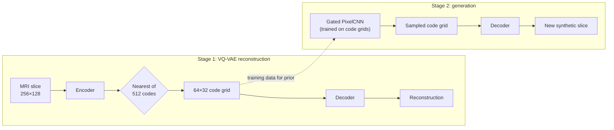

## II Feasibility Review (23/10)

### 1 User Need, Scope \& Acceptance Criteria

#### 1.1 User Need

* Production of synthetic medical cohorts for hip MRI training data. Requires generated images that satisfy:

  1. Fidelity (plausible anatomy)
  2. Diversity (no model collapse)
  3. Privacy (no memorised scans from training)

#### 1.2 Scope

* Generating 2D axial pelvic MRI slices (256 × 128) and comparing them with simpler VAE baselines on held-out patients.

#### 1.3 Acceptance Criteria

1. **Reconstruction fidelity:** Mean SSIM of VQ-VAE reconstructions (> 0.6)
2. **Generated-slice fidelity:** Mean SSIM of each sample to nearest real slice (> 0.2)
3. **No Memorisation:**

   * (a) Proportion of generated samples above 99th percentile NN-SSIM of test patients (< test-patient rate)
   * (b) Proportion of near-duplicate samples (NN-SSIM > 0.95) (0)
4. **Coverage \& Density:**

   * (a) Mean Pairwise SSIM (within ±25% of Real Test Slices)
   * (b) Fidelity and diversity metrics (Naeem et al., 2020) (> 50% of real patient density \& coverage)
5. **Resource Budget:**

   * (a) Peak training VRAM (< 16 GB)
   * (b) Average generation time per slice on an A100 (< 1 s)

### 2\. Model Choice \& Course Concepts

* **VQ-VAE (van den Oord et al., 2017):** the encoder downsamples the image into a 64 × 32 grid, with each position assigned one of 512 learned codes. The codebook is gradually updated using exponential moving averages. It uses a straight-through estimator to allow gradients to pass through the discrete code selection during training.
* **Gated PixelCNN Prior (van den Oord et al., 2016):** learns the patterns and relationships between the VQ-VAE's discrete codes to generate new code grids one position at a time. Then the VQ-VAE decoder converts these grids into synthetic MRI slices.
* **Baseline:** a Gaussian VAE (Kingma \& Welling, 2014) uses the same encoder and decoder architecture as the VQ-VAE to compare its discrete code representation \& the prior against the VAE’s latent representations in generating synthetic MRI slices.

### 3\. Preliminary Feasibility Evidence

* **Data:** 11460 / 660 / 540 slices from 31 / 4 / 3 patients (train / validate / test). Confirmed no patient leakage between splits. 60 slices which were 256 x 144 were centre-cropped. Pixel values were percentile-clipped and min-max scaled to \[0, 1] as SSIM and PSNR require known range.
* **Smoke Test:** 256 slices per split. Peak VRAM of 1.1 GB per autoencoder, 5.5 GB for prior. Evidence of codebook collapse (2/512 codes used), plan to initialise codebook with encoder outputs and reinitialise unused codes every 20 training iterations.

### 4\. Risks, Budget \& Fallback

#### 4.1 Risks

* **Prior over-fitting:** Implement mirror training samples, dropout, weight decay, and decreasing number of channels based on training vs validation performance
* **Unfair baseline:** Test VAE with varying KL-weights

#### 4.2 Budget

* **A100:** 4 GPU hours for main training, prediction and evaluation pipeline and 13 GPU-hours for side experiments (regularisation comparison and hyperparameter optimisation)

#### 4.3 Next

* Optimise regularisation of prior and KL weight of VAE. Then train models and evaluate pairwise / nearest neighbour SSIM, diversity, memorisation, and whether model collapse occurs.

## III Dependencies

### 1\. Packages

| Python | PyTorch | torchvision | nibabel | NumPy | matplotlib | tqdm |
|---|---|---|---|---|---|---|
| 3.13.2 | 2.7.0 (CUDA 12.6) | 0.22.0 | 5.4.2 | 2.2.6 | 3.10.3 | 4.67.1 |

Run on Rangpur A100.

### 2\. Reproducibility
- Fixed seeds: 42 (training), 0 (sampling)
- Successfully reproduced all metrics (predict.py)

### 3\. Usage

| File | Contents |
|---|---|
| `slurm/` | Rangpur scripts |
| `dataset.py` | Nifti loading, data processing, data audit |
| `modules.py` | VQ-VAE, VAE, EMA codebook, Gated PixelCNN |
| `train.py` | Training, validation, checkpointing, produces loss curves |
| `predict.py` | Tests benchmark, sampling, memorisation, produces figures |
| `experiments.py` | Prior regularisation, VAE KL optimisation |

```bash
conda activate torch && pip install --no-cache-dir nibabel==5.4.2
mkdir -p outputs/logs
sbatch slurm/smoke_test.sbatch      # smoke test
bash slurm/run_all.sh               # trains VAE, VQ-VAE, CNN prior, and runs predict.py
sbatch slurm/experiments.sbatch     # side experiments: VAE KL optimisation, and prior regularisation
```

## IV Example Inputs, Outputs \& Visual Plots

### 1\. VQ-VAE Training Curves
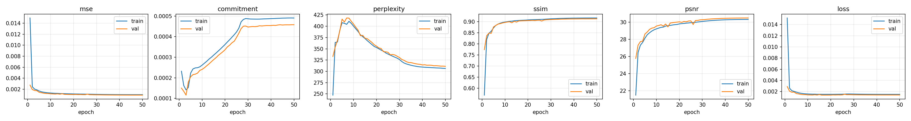

### 2\. PixelCNN Prior Training Curves
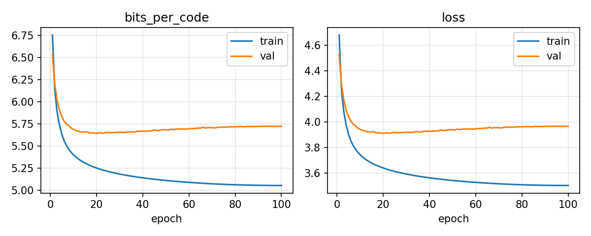

### 3\. VAE Training Curves 
#### 3.1 KL 1
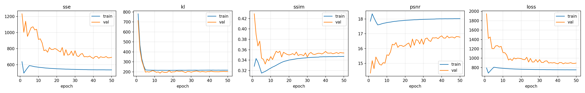

#### 3.2 KL 0.1
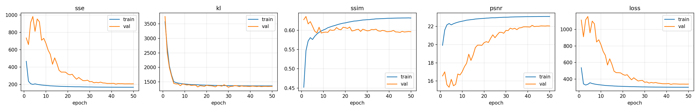

#### 3.3. KL 0.01
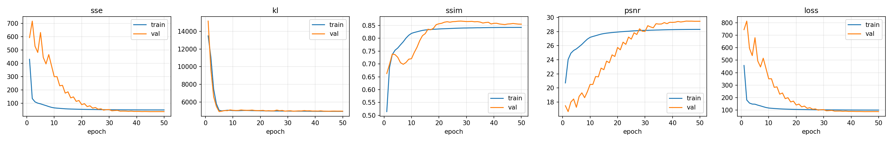

### 4\. VAE \& VQ-VAE Reconstructions
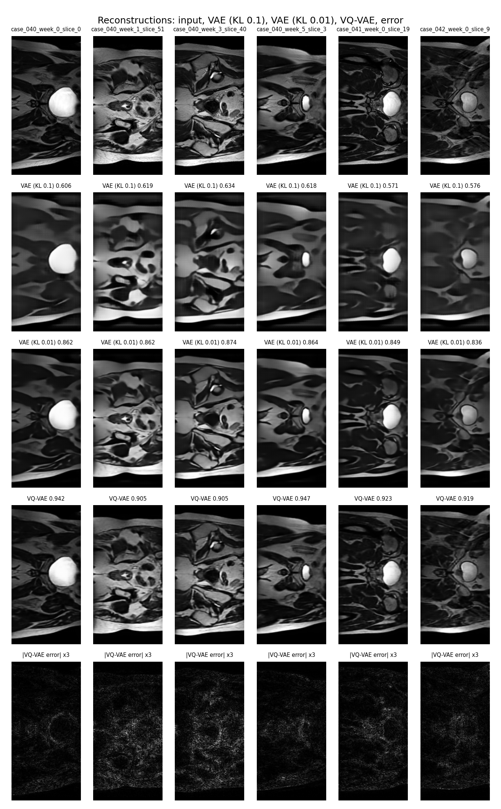

### 5\. VQ-VAE Generated Slices
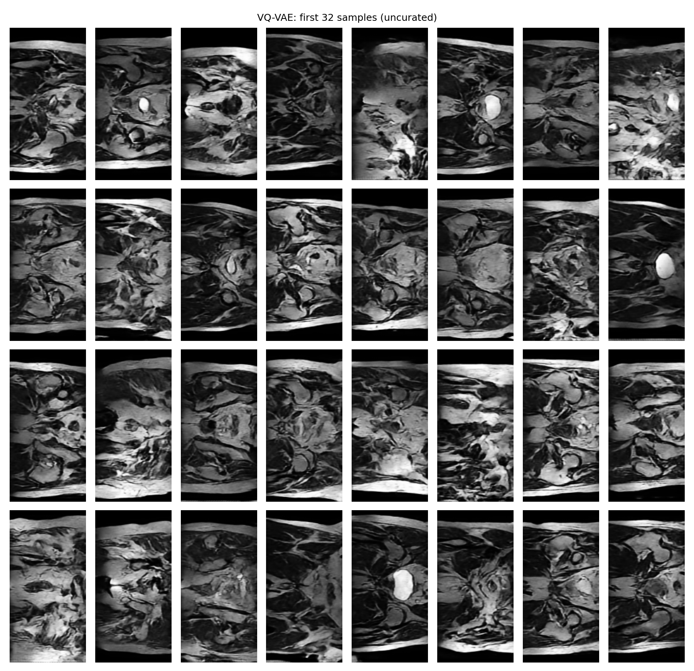

### 6\. VAE Generated Slices (KL 1, first run)
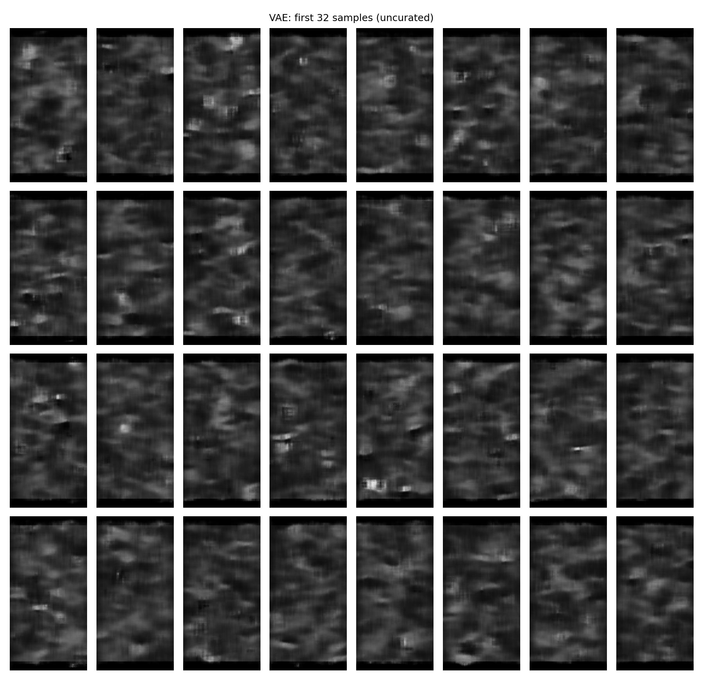


## V Pre-Processing

1. Loaded Nifti slices with Nibabel
2. Centre-cropped the 60 slices of dimensions 256 x 144 to 256 x 128 to make all 12660 slices have identical dimensions
3. Normalised each slice by clipping to 0.5th-99.5th percentiles (to ensure outliers don't compress remaining contrast scale), then scaled pixel values to [0,1]. This is because calculating SSIM requires model inputs and output scales must match, as output is sigmoid values, input must be scaled to [0,1].
4. A left-right mirrored copy of every training slice was also added to the PixelCNN prior's training set as overfitting was previously observed.
5. Ensured that the given training, validation, test split did not contain patient leakage.

| Split | Slices | Patients | 
|---|---|---|
| Train | 11460 | 31 |
| Validate | 660 | 4 | 
| Test | 540 | 3 | 


## VI Investigation of the Open Research Dilemma

### 1\. Quantitative Benchmarking

#### 1.1 VQ-VAE Results


| | Real test slices | VAE KL 0.1 | VAE KL 0.01 | **VQ-VAE + PixelCNN** |
|---|---|---|---|---|
| Reconstruction SSIM | N/A | 0.603 ± 0.029 | 0.859 ± 0.017 | **0.917 ± 0.015** |
| Reconstruction PSNR | N/A | 22.06 | 29.76 | **30.49** |
| NN-SSIM of samples | 0.286 | 0.211 | 0.114 | **0.229** |
| Possible copies | 1.1% | 0.0% | 0.0% | **0.3%** |
| Near-duplicates | 0 | 0 | 0 | **0** |
| Pairwise SSIM | 0.197 | 0.218 | 0.086 | **0.148** |
| FID | 61.6 | 321.9 | 448.1 | **111.9** |
| Density / coverage | 0.349 / 0.189 | 0 / 0 | 0 / 0 | **0.140 / 0.088** |

NOTE: All models reconstructed the same 540 test slices and generated 1000 synthetic slices

- **NN-SSIM**: average of each generated sample's SSIM to its nearest training slice
- **Possible Copy**: is a generated slice with NN-SSIM exceeding 99th percentile of test set (0.394)
- **Near-Duplicate**: is a generated slice with NN-SSIM > 0.95
- **FID, Density \& Coverage**: use Inception features

#### 1.2 VQ-VAE Results Interpretation
1. **Reconstruction**: VQ-VAE reconstructs every test slice with SSIM exceeding 0.6 (0.886 minimum, 0.917 average) satisfying task sheet requirement
2. **Generation**: Only the VQ-VAE + PixelCNN Prior produces real anatomy as the VAE has no sample on the real (training) data manifold (density 0) at all KL weights. The VQ-VAE + PixelCNN Prior reached 80\% of the test (real) patient NN-SSIM, 40\% of its density and 47\% of its coverage.

#### 1.3 Baseline VAE KL Weight Optimisation
| KL weight | Recon. SSIM | FID | Density / coverage |
|---|---|---|---|
| 1 | 0.372 | 433.8 | 0 / 0 |
| 0.1 | 0.602 | **319.5** | 0 / 0 |
| 0.01 | **0.867** | 440.6 | 0 / 0 |

#### 1.4 PixelCNN Prior Regularisation
Without regularisation, the PixelCNN Prior overfit as the validation bits/code increased after epoch 8 from 5.84 to 8.07.

| Prior | Best Epoch | Min val bits/code | Val − train gap (ep. 100) | Params |
|---|---|---|---|---|
| None | 8 | 5.837 | 3.89 | 10.9M |
| + mirroring | 7 | 5.713 | 2.66 | 10.9M |
| + dropout 0.2 | 7 | 5.665 | 2.15 | 10.9M |
| + weight decay | 6 | 5.664 | 2.13 | 10.9M |
| **+ width 64** | **20** | **5.654** | **0.67** | **3.0M** |

NOTE each subsequent row is cumulative of the regularisation techniques above (i.e. bottom row is with all 4 forms of regularisation combined

Furthermore, adding all 4 forms of regularisation together improved generation (FID 135.5 vs 111.9, coverage 0.068 vs 0.088) and halved sampling time.

#### 1.5 Latent Interpolation Between Synthetic and Training Slices
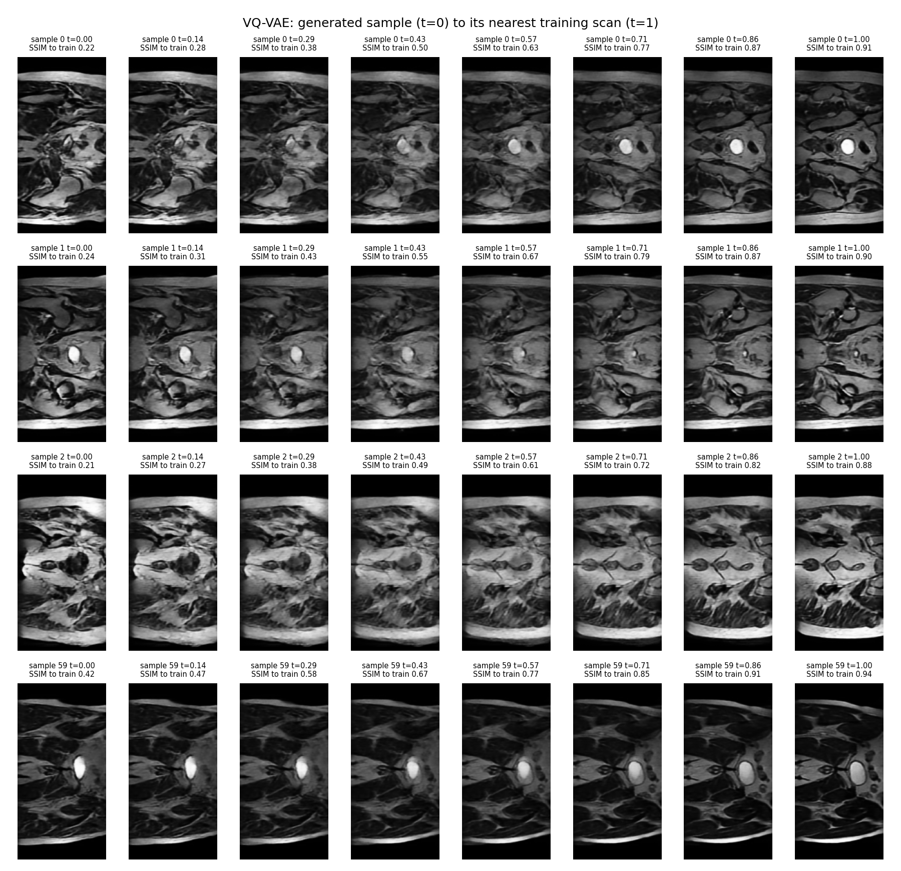

SSIM to the training slice clearly increases from the generated slice to its nearest training slice, and both sides are demonstrably different further suggesting a lack of memorisation.

### 2\. Resource Profiling

| Model | Params | Train VRAM | Train time | Recon. latency (batch 1) | Generation / slice | Inference VRAM |
|---|---|---|---|---|---|---|
| VAE | 830849 | 1.1 GB | 4.8 min | 1.1–1.3 ms | 0.13 ms | 0.55 GB |
| VQ-VAE | 822593 | 1.1 GB | 5.4 min | 1.7 ms | n/a | 0.66 GB |
| PixelCNN prior | 2969152 | 3.3 GB | 77 min | n/a | **0.51 s** | 1.0 GB |

### 3\. Qualitative Error Autopsies

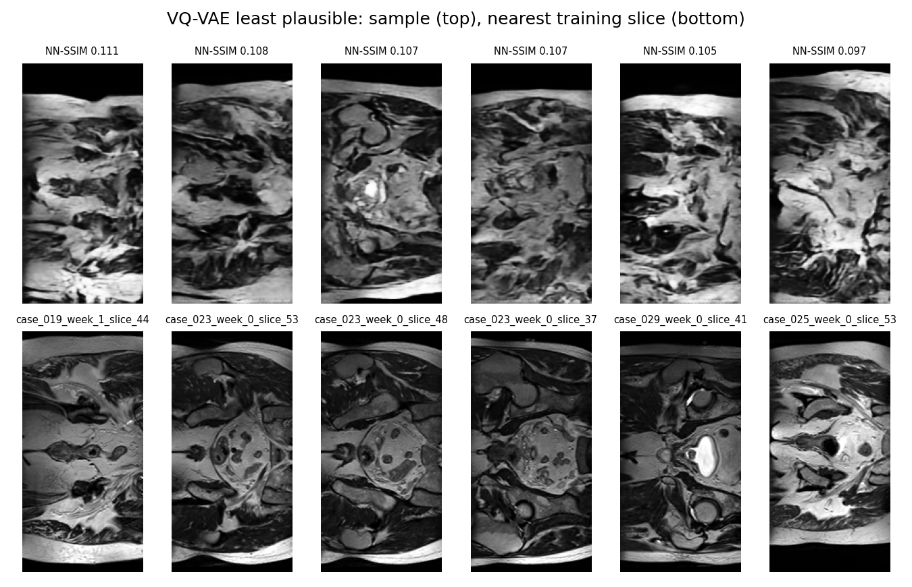

| Failure | Likely Cause | Consequence |
|---|---|---|
| **Top-Bottom Asymmetry**: generated images lack the paired organs and largely symmetric structures of training slices | The PixelCNN Prior generates each code autoregressively, so the opposite sides of a training slice may have limited influence | Anatomically implausible slices, unsuitable for tasks relying on symmetric landmarks |
| **Lacks Recognisable Anatomy**: structures are not well-defined unlike training slices | The PixelCNN does not necessarily learn a hierarchical understanding of pelvic anatomy, so it likely blends together structures from different slices | Off-manifold images that could teach downstream models non-existent anatomy |
| **Incomplete Lower Body Outline**: generated MRI slices have no defined bottom edge unlike training slices | Bottom rows are generated last and autoregressively, so this is likely the result of errors in previous codes | Results in an unrealistic body shape and would function as an obvious sign of synthetic data |

### 4\. Engineering Recommendations \& Trade-Offs

#### 4.1 Acceptance Criteria

| AC | Target | Result |
|---|---|---|
| 1. Reconstruction SSIM | > 0.6 | 0.917 |
| 2. Sample NN-SSIM | > 0.2 | 0.229 |
| 3. Possible copies / near-duplicates | < real rate / 0 | 0.3% vs 1.1% / 0 |
| 4a. Pairwise SSIM | ±25% of real | 0.148 vs 0.197 (real) |
| 4b. Density, coverage | > 50% of real | 40%, 47% |
| 5. VRAM / time per slice | < 16 GB / < 1 s | 3.3 GB / 0.51 s |

AC1, AC2, AC3 and AC5 were achieved by the VQ-VAE. However, AC4 was not with pairwise SSIM slightly outside ±25% of real (25.2% below) and density and coverage being slightly under the set expectation.

#### 4.2 Conclusions

- **Privacy:** There was no evidence of patient memorisation in the VQ-VAE + PixelCNN Prior's generation of synthetic slices which suggests it is suitable from a privacy perspective
- **Diversity:** There is reasonable diversity and coverage of generated samples
- **Fidelity:** Whilst the VQ-VAE + PixelCNN Prior well exceeded the VAE baseline, and was excellent at reconstruction, section 3 shows that some generated synthetic slices were anatomically implausible, showing there are still improvements necessary for synthetic datasets to be as useful as real patient datasets.
- **vs Baseline**: The additional complexity of the VQ-VAE + PixelCNN Prior is absolutely necessary for synthetic image generation in comparison to VAE, as it resulted in significant improvements in reconstruction and the production of some plausible generated synthetic slices (even if not all were so) in comparison to the VAE which failed to produce any semblance of anatomic fidelity in its generated images.
- **Extensions**: Experiment further with hierarchical models (e.g. VQ-VAE2) to improve capacity of generative models to produce synthetic slices with realistic anatomical features.


## VII Artificial Intelligence Usage Disclosure

Anthropic Claude was used for the following:
- Research of PixelCNN Prior & Regularisation
- Planning of implemented codebase functions
- Debugging
- Some docstrings / in line comments
- Slurm scripts
- Construction of mermaid algorithm visualisation

All code and comments was verified and empirically tested.

## VIII References

- Dhariwal, P., Jun, H., Payne, C., Kim, J. W., Radford, A., & Sutskever, I. (2020). Jukebox: A generative model for music. *arXiv preprint arXiv:2005.00341*.
- Heusel, M., Ramsauer, H., Unterthiner, T., Nessler, B., & Hochreiter, S. (2017). GANs trained by a two time-scale update rule converge to a local Nash equilibrium. *Advances in Neural Information Processing Systems, 30*.
- Kingma, D. P., & Welling, M. (2014). Auto-encoding variational Bayes. *International Conference on Learning Representations (ICLR)*.
- Loshchilov, I., & Hutter, F. (2019). Decoupled weight decay regularization. *International Conference on Learning Representations (ICLR)*.
- Naeem, M. F., Oh, S. J., Uh, Y., Choi, Y., & Yoo, J. (2020). Reliable fidelity and diversity metrics for generative models. *International Conference on Machine Learning (ICML)*, 7176–7185.
- Salimans, T., Karpathy, A., Chen, X., & Kingma, D. P. (2017). PixelCNN++: Improving the PixelCNN with discretized logistic mixture likelihood and other modifications. *International Conference on Learning Representations (ICLR)*.
- Szegedy, C., Vanhoucke, V., Ioffe, S., Shlens, J., & Wojna, Z. (2016). Rethinking the Inception architecture for computer vision. *IEEE Conference on Computer Vision and Pattern Recognition (CVPR)*, 2818–2826.
- The University of Queensland. (2026). *COMP3710 Pattern Recognition and Analysis: Report specification* (v2.3), Appendix: HipMRI Study for prostate cancer radiotherapy dataset and Appendix B (Nifti loading code).
- van den Oord, A., Kalchbrenner, N., Vinyals, O., Espeholt, L., Graves, A., & Kavukcuoglu, K. (2016). Conditional image generation with PixelCNN decoders. *Advances in Neural Information Processing Systems, 29*.
- van den Oord, A., Vinyals, O., & Kavukcuoglu, K. (2017). Neural discrete representation learning. *Advances in Neural Information Processing Systems, 30*.
- Wang, Z., Bovik, A. C., Sheikh, H. R., & Simoncelli, E. P. (2004). Image quality assessment: From error visibility to structural similarity. *IEEE Transactions on Image Processing, 13*(4), 600–612.